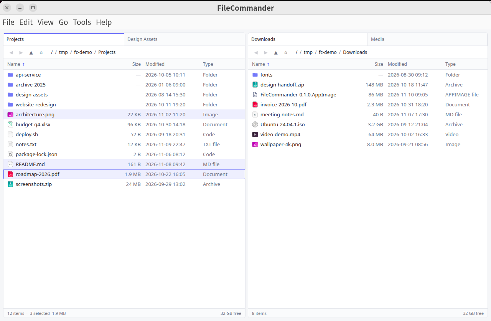
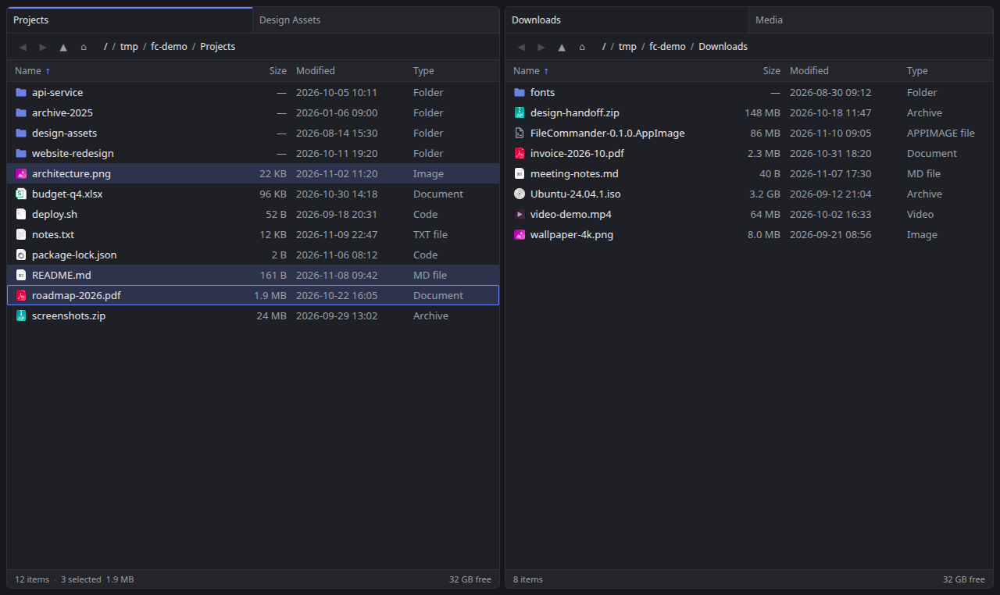
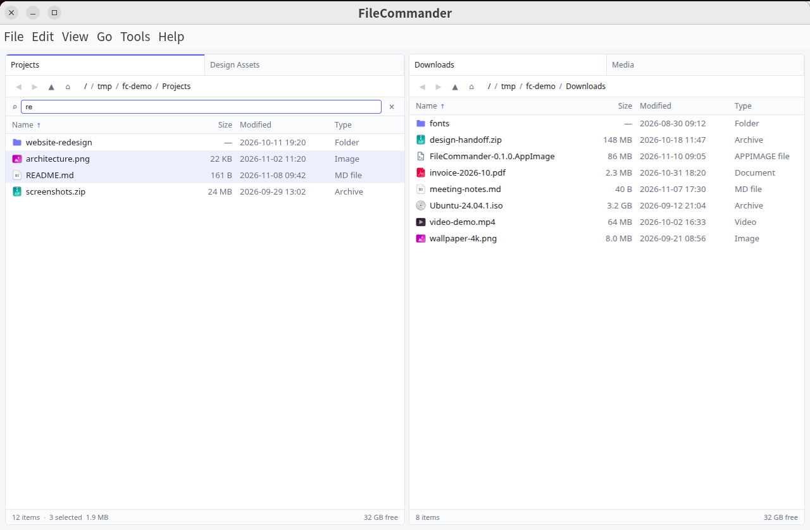
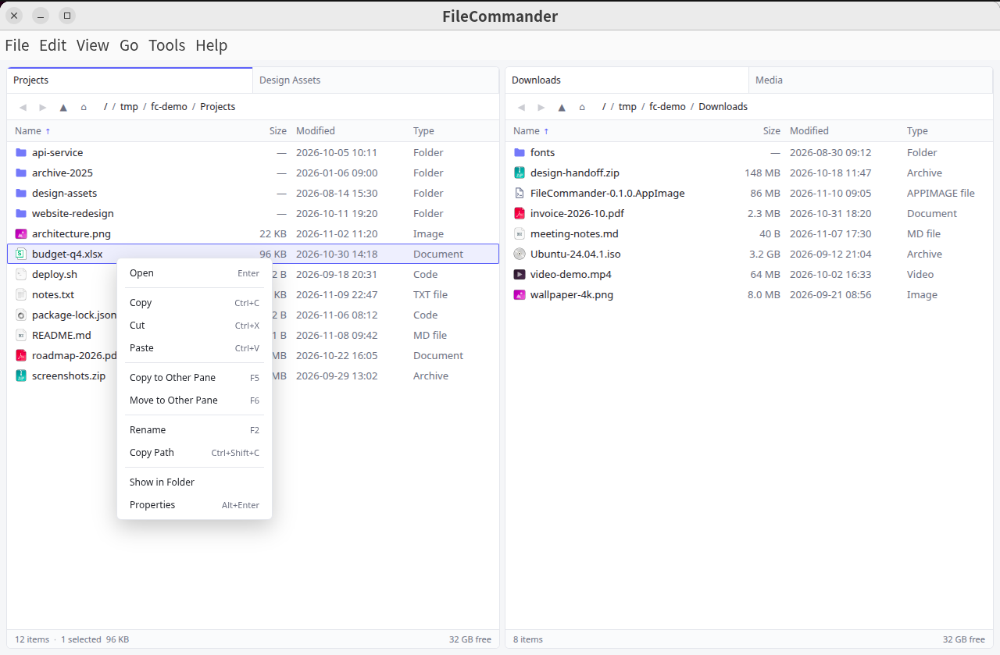
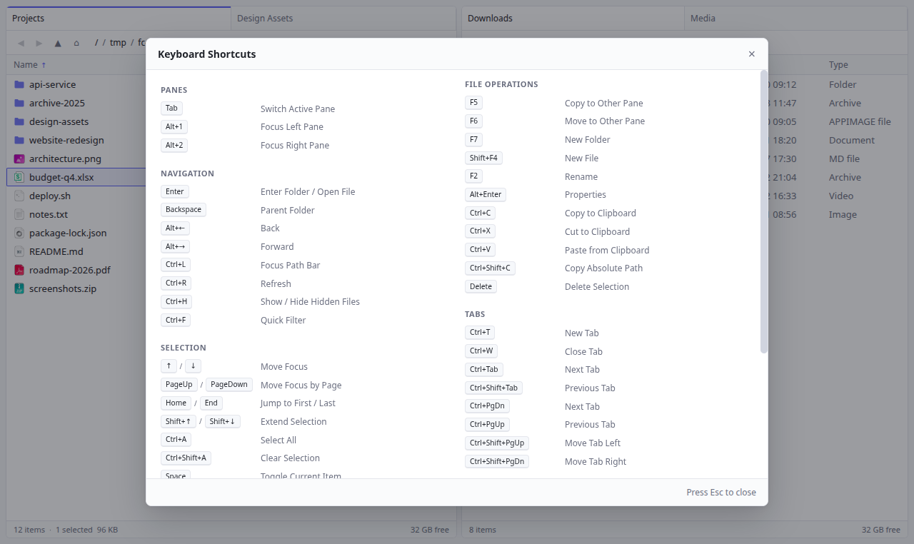
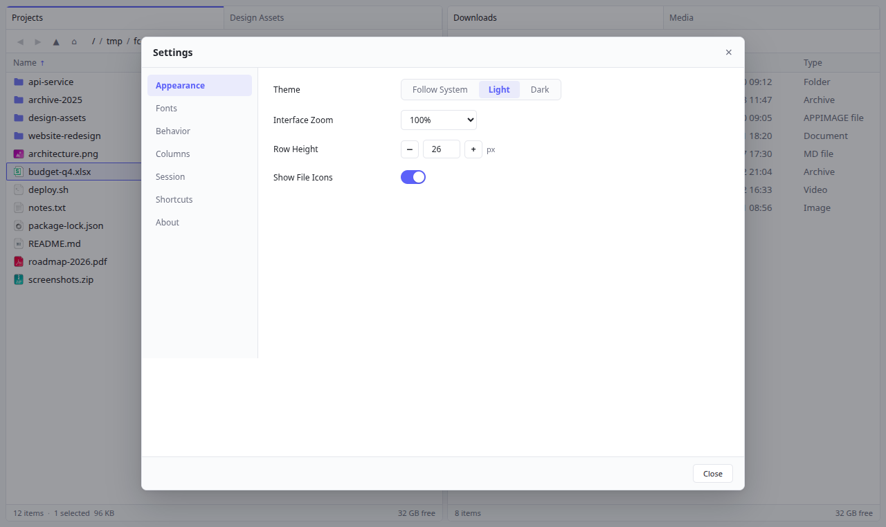

<p align="center">
  
</p>

<h1 align="center">FileCommander</h1>

<p align="center">
  A lightweight, dual-pane, multi-tab, keyboard-first file manager for Linux and Windows.<br />
  Built with Electron + Vue 3 and distributed as a CanBox desktop app.
</p>

<p align="center">
  <a href="#english">English</a> · <a href="#简体中文">简体中文</a>
</p>

---

<a id="english"></a>

## English



FileCommander is a fast, no-frills file manager for people who live on the keyboard. Two panes, up to seven tabs per pane, a safe transfer queue, and instant filtering — with no indexing service, no telemetry, and no built-in viewer getting in your way.

### Features

- **Dual panes, multi-tab** — independent left/right panes, up to 7 tabs per side, per-tab history, and optional session restore on startup.
- **Built for large folders** — two-phase directory loading (names first, sizes/dates streamed in) and a virtualized list that stays smooth in folders with 100,000+ entries.
- **Safe copy & move queue** — background tasks with progress, speed, ETA and cancel; conflict handling with overwrite / skip / rename / "apply to all"; copying into the same folder silently creates `copy1_name` / `copy2_name` instead of asking; temporary file + atomic rename so a failed copy never leaves a half-written file. `.asar` archives are handled as plain files.
- **Complete keyboard workflow** — navigate, select, rename, create, copy, move, switch panes and reorder tabs without touching the mouse. Press `F1` for the full cheat sheet.
- **Quick filter & type-ahead** — filter the current folder with `Ctrl+F` without losing your selection; just start typing to jump to a matching name.
- **Clipboard that cooperates** — internal copy/cut/paste between panes, plus path-text interop with other apps and `Ctrl+Shift+C` to copy absolute paths.
- **Drag & drop both ways** — drag between panes, out to your system file manager, or files in from the system (copied by default).
- **Open files sensibly** — `Enter` or double-click opens with the system default app; executables ask for confirmation; unassociated or unreadable files produce a clear message instead of silently failing.
- **Make it yours** — system/light/dark theme, interface zoom, per-area fonts, row height, column widths, hidden files, directories-first, and window/session restore.
- **Bilingual UI** — English and 简体中文; follows the system language by default and can be switched at runtime via **Tools → Language**.
- **Native menus** — every command is also reachable from the application menu, with shortcuts shown inline.

### Screenshots

| Dark theme | Quick filter |
| --- | --- |
|  |  |

| Context menu | Keyboard shortcuts (F1) |
| --- | --- |
|  |  |



### Keyboard shortcuts

| Area | Keys | Action |
| --- | --- | --- |
| Panes | `Tab` / `Alt+1` / `Alt+2` | Switch active pane / focus left / focus right |
| Navigation | `Enter` · `Backspace` | Enter folder or open file · go to parent folder |
| | `Alt+←` / `Alt+→` | Back / forward |
| | `Ctrl+L` · `Ctrl+R` · `Ctrl+H` · `Ctrl+F` | Path bar · refresh · hidden files · quick filter |
| Selection | `↑` `↓` `PageUp` `PageDown` `Home` `End` | Move focus |
| | `Shift+↑` / `Shift+↓` | Extend selection |
| | `Ctrl+A` / `Ctrl+Shift+A` | Select all / clear selection |
| | `Space` / `Insert` | Toggle item / toggle and move down |
| Files | `F5` / `F6` | Copy / move to the other pane |
| | `F7` / `Shift+F4` / `F2` | New folder / new file / rename |
| | `Alt+Enter` | Properties |
| | `Ctrl+C` / `Ctrl+X` / `Ctrl+V` | Copy / cut / paste |
| | `Ctrl+Shift+C` | Copy absolute path |
| | `Delete` | Move selection to trash |
| Tabs | `Ctrl+T` / `Ctrl+W` | New / close tab |
| | `Ctrl+Tab` / `Ctrl+Shift+Tab` | Next / previous tab |
| | `Ctrl+Shift+PgUp` / `Ctrl+Shift+PgDn` | Move tab left / right |
| View | `Ctrl+=` / `Ctrl+-` / `Ctrl+0` | Zoom in / out / reset |
| App | `Ctrl+,` / `F1` / `Ctrl+Q` | Settings / shortcuts help / quit |

### Installation

FileCommander is a CanBox desktop app and ships through CanBox Manager.

1. Open **CanBox Manager**.
2. Go to **Repositories → Add repository**.
3. Add this repository URL:

   ```
   https://github.com/rexlevin/cb-filecommander
   ```

4. Install **FileCommander** from the catalog.

Requirements: Linux (X11/Wayland) or Windows 10/11, with CanBox Manager installed. The app runs on Electron 42.5.1.

### Build from source

Requirements: Node.js 20.19+ (or 22.12+) and npm.

```bash
git clone https://github.com/rexlevin/cb-filecommander.git
cd cb-filecommander
npm install
npm run build
npm start
```

`npm start` launches the app through `canbox-core` (expected at `../canbox-core`). To run the built renderer without the CanBox runtime:

```bash
npx electron .
```

Settings then fall back to the app's own `userData` directory.

For UI development with hot reload, run `npm run dev` (Vite on port 5182) and start the app with `NODE_ENV=development` so it loads the dev server.

### Localization

The interface ships in English and Simplified Chinese. By default it follows the system language; switch at any time from **Tools → Language → Follow System / 简体中文 / English**. The choice is persisted, and the native menu is rebuilt immediately.

### License

[Apache-2.0](LICENSE)

---

<a id="简体中文"></a>

## 简体中文


FileCommander 是一款轻量、双栏、多标签、键盘优先的文件管理器，面向 Linux 与 Windows，以 CanBox 桌面应用形式分发。没有索引服务、没有遥测，也没有内置查看器打断你的操作。

### 功能特性

- **双栏 + 多标签**：左右面板互相独立，每侧最多 7 个标签，各自保留浏览历史，可恢复上次会话。
- **为超大目录而生**：两阶段列目录（先出名称，大小/时间流式补齐）+ 虚拟列表，10 万项目录依然流畅。
- **安全的复制/移动队列**：后台任务带进度、速度、剩余时间与取消；冲突支持覆盖 / 跳过 / 重命名 / 全部应用；在同一目录内复制时不再询问，直接生成 `copy1_原名` / `copy2_原名`；先写临时文件再原子重命名，失败不会留下半截文件；`.asar` 归档按普通文件处理。
- **完整键盘操作**：导航、选择、重命名、新建、复制、移动、切面板、调标签顺序都能脱离鼠标完成，按 `F1` 查看全部快捷键。
- **快速筛选与类型定位**：`Ctrl+F` 筛选当前目录且不影响选择；直接输入字符即可跳到匹配项。
- **剪贴板互操作**：面板间内部复制/剪切/粘贴，并支持与其他程序的路径文本互通，`Ctrl+Shift+C` 复制绝对路径。
- **双向拖拽**：面板之间拖动、拖出到系统文件管理器、从系统拖入（默认复制）。
- **合理的打开方式**：`Enter` 或双击用系统默认程序打开；可执行文件二次确认；无关联或无法打开时给出明确提示。
- **可定制外观**：跟随系统/浅色/深色主题、界面缩放、分区字体、行高、列宽、显示隐藏文件、目录优先、窗口与会话恢复。
- **中英双语**：默认跟随系统语言，可随时在 **工具 → 语言** 中切换，选择会被持久化。
- **原生菜单**：所有命令都能从应用菜单触发，并直接标注快捷键。

### 截图

| 深色主题 | 快速筛选 |
| --- | --- |
|  |  |

| 右键菜单 | 快捷键帮助（F1） |
| --- | --- |
|  |  |


### 快捷键

| 分类 | 按键 | 功能 |
| --- | --- | --- |
| 面板 | `Tab` / `Alt+1` / `Alt+2` | 切换活动面板 / 聚焦左面板 / 聚焦右面板 |
| 导航 | `Enter` · `Backspace` | 进入目录或打开文件 · 上级目录 |
| | `Alt+←` / `Alt+→` | 后退 / 前进 |
| | `Ctrl+L` · `Ctrl+R` · `Ctrl+H` · `Ctrl+F` | 路径栏 · 刷新 · 隐藏文件 · 快速筛选 |
| 选择 | `↑` `↓` `PageUp` `PageDown` `Home` `End` | 移动焦点 |
| | `Shift+↑` / `Shift+↓` | 扩展选择 |
| | `Ctrl+A` / `Ctrl+Shift+A` | 全选 / 取消全选 |
| | `Space` / `Insert` | 切换当前项 / 切换并下移 |
| 文件 | `F5` / `F6` | 复制 / 移动到另一栏 |
| | `F7` / `Shift+F4` / `F2` | 新建文件夹 / 新建文件 / 重命名 |
| | `Alt+Enter` | 属性 |
| | `Ctrl+C` / `Ctrl+X` / `Ctrl+V` | 复制 / 剪切 / 粘贴 |
| | `Ctrl+Shift+C` | 复制绝对路径 |
| | `Delete` | 删除到回收站 |
| 标签 | `Ctrl+T` / `Ctrl+W` | 新建 / 关闭标签 |
| | `Ctrl+Tab` / `Ctrl+Shift+Tab` | 下一个 / 上一个标签 |
| | `Ctrl+Shift+PgUp` / `Ctrl+Shift+PgDn` | 标签左移 / 右移 |
| 视图 | `Ctrl+=` / `Ctrl+-` / `Ctrl+0` | 放大 / 缩小 / 重置缩放 |
| 应用 | `Ctrl+,` / `F1` / `Ctrl+Q` | 设置 / 快捷键帮助 / 退出 |

### 安装

FileCommander 是 CanBox 桌面应用，通过 CanBox Manager 安装：

1. 打开 **CanBox Manager**。
2. 进入 **仓库 → 添加仓库**。
3. 填入仓库地址：

   ```
   https://github.com/rexlevin/cb-filecommander
   ```

4. 在应用目录中安装 **FileCommander**。

运行环境：Linux（X11/Wayland）或 Windows 10/11，需已安装 CanBox Manager；应用基于 Electron 42.5.1。

### 从源码构建

需要 Node.js 20.19+（或 22.12+）与 npm。

```bash
git clone https://github.com/rexlevin/cb-filecommander.git
cd cb-filecommander
npm install
npm run build
npm start
```

`npm start` 通过 `canbox-core` 启动（预期位于 `../canbox-core`）。若只想运行已构建的渲染层：

```bash
npx electron .
```

此时设置会回退到应用自身的 `userData` 目录。

界面开发可用 `npm run dev` 启动 Vite 开发服务器（端口 5182），再以 `NODE_ENV=development` 启动应用以加载开发服务器。

### 许可

[Apache-2.0](LICENSE)
